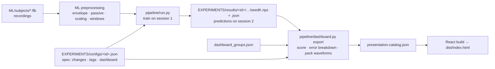

# EMG → ankle torque

We predict the torque a person makes at the ankle from four surface EMG channels (gastrocnemius medialis and lateralis,
soleus, tibialis anterior) plus the ankle angle. The main model is a small LSTM. It is trained on one recording session
("test") and tested on a second session ("retest") at eight fixed ankle angles. Older MATLAB code in the same
repository models the same relation with system identification (PNLM models in `functions/`).

**Results:** open [`EXPERIMENTS/dashboard_react/dist/index.html`](EXPERIMENTS/dashboard_react/dist/index.html) in a
browser. The file is self-contained, so it needs no server and no Python. It opens on the default model, **A0**: active
torque (each session's own passive torque from its relaxed holds subtracted), EMG divided by the session-1 maximum, a
0.2 s window, and no calibration.

## Repository map

| Folder | What it holds | Start here |
| --- | --- | --- |
| `EXPERIMENTS/configs/` | One JSON spec per experiment: settings, description, tags, dashboard place | [`docs/EXPERIMENTS.md`](docs/EXPERIMENTS.md) |
| `EXPERIMENTS/pipeline/` | Run an experiment, run a queue, score, export to the dashboard | `python -m EXPERIMENTS.pipeline.dashboard --help` |
| `EXPERIMENTS/results/` | Saved predictions (`seedK.npz`) and run metadata (`seedK.json`) | written by `pipeline/run.py` |
| `EXPERIMENTS/dashboard_react/` | The React dashboard and its data (`src/data/presentation-catalog.json`) | `dist/index.html` |
| `EXPERIMENTS/reports/` | Written study reports; `normalization/REPORT.md` is the current one | [`REPORT.md`](EXPERIMENTS/reports/normalization/REPORT.md) |
| `EXPERIMENTS/analysis/` | One-off analysis scripts behind the reports | each script's docstring |
| `ML/research/` | Data loading, passive-torque models, EMG scaling, windows, training used by the experiments | [`docs/ARCHITECTURE.md`](docs/ARCHITECTURE.md) |
| `ML/preprocessing/`, `ML/models/`, `ML/training/`, `ML/evaluation/` | Shared reading, filtering, model and training code | [`docs/ARCHITECTURE.md`](docs/ARCHITECTURE.md) |
| `ML/subjects/` | The six `.flb` recordings and their metadata: not in git (participant data; the repository is public). Get them privately from the lab and put them here | [`docs/DATA.md`](docs/DATA.md) |
| `ML/preprocessing/pipeline.py`, `ML/training/benchmark.py`, `ML/inference.py` | The audited pipeline from `main`: trial manifests, run packages, inference | [`docs/PIPELINE_COMPARISON.md`](docs/PIPELINE_COMPARISON.md) |
| `ML/archive/` | The first experiment harness, kept for traceability | its README |
| `functions/`, `exp_gui/`, `exp_model/`, `ES_sandbox/` | MATLAB: system identification, experiment GUI, real-time Simulink model | [`docs/ARCHITECTURE.md`](docs/ARCHITECTURE.md) |
| `presentations/` | Meeting decks, figures and videos | its README |
| `scripts/`, `.github/workflows/` | Run scripts and the CI check that the transferred artifacts are present | the workflow file |

## Quickstart

Python 3.11 is the tested version (see `EXPERIMENTS/requirements-handoff.txt`). Run everything from the repository root.

macOS / Linux:

```bash
python3.11 -m venv .venv
.venv/bin/python -m pip install -r EXPERIMENTS/requirements-handoff.txt
open EXPERIMENTS/dashboard_react/dist/index.html
```

Windows (PowerShell):

```powershell
py -3.11 -m venv .venv
.\.venv\Scripts\python.exe -m pip install -r EXPERIMENTS/requirements-handoff.txt
start EXPERIMENTS/dashboard_react/dist/index.html
```

Rebuilding the dashboard also needs Node.js 18 or newer (`npm ci` once in `EXPERIMENTS/dashboard_react`).

## Run an experiment and put it on the dashboard

```bash
# 1. write EXPERIMENTS/configs/TEAM01_active_dropout.json (see docs/EXPERIMENTS.md)
# 2. train: six people, session 1 -> 2, three seeds
.venv/bin/python -m EXPERIMENTS.pipeline.run_queue --exps TEAM01_active_dropout \
    --subjects YES JM EG IES CH HM --directions S1toS2 --seeds 0 1 2 --workers 6
# 3. name it and place it in a sidebar group
.venv/bin/python -m EXPERIMENTS.pipeline.dashboard tag TEAM01_active_dropout --label "Dropout 0.2" --group Models \
    --description "A0 with dropout 0.2" --tag dropout
# 4. score it and rebuild dist/index.html
.venv/bin/python -m EXPERIMENTS.pipeline.dashboard build TEAM01_active_dropout
```

## How data flows



## Documentation

- [`docs/EXPERIMENTS.md`](docs/EXPERIMENTS.md): the spec format and the full run → tag → build workflow
- [`docs/BASELINE.md`](docs/BASELINE.md): the current baseline's windows, overlap and target, compared with Zhang 2022 and Truong 2023
- [`docs/CALIBRATION.md`](docs/CALIBRATION.md): the default target and the error breakdown (no calibration)
- [`docs/DATA.md`](docs/DATA.md): subjects, sessions, positions, trial types and the `.flb` format
- [`docs/ARCHITECTURE.md`](docs/ARCHITECTURE.md): what each module does, Python and MATLAB
- [`docs/PIPELINE_COMPARISON.md`](docs/PIPELINE_COMPARISON.md): the experiment pipeline versus the audited pipeline on `main`
- [`EXPERIMENTS/HANDOFF.md`](EXPERIMENTS/HANDOFF.md): checking the transferred artifacts

## People

Capstone project at McGill University, in Robert Kearney's lab (REKLAB). Contributors: Krasimir Kirov, Aiman Feghoul,
Ehsan Sobhani, Robert Kearney and the GitHub user Dramocrystal.

Licensed under the GNU GPL v3 (see `LICENSE`).
