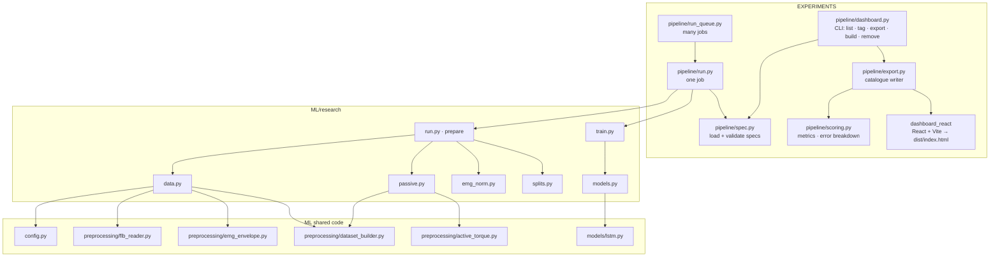

# Architecture

Two Python layers do the work. `ML/` reads the recordings and trains models. `EXPERIMENTS/` holds experiment specs,
runs them through `ML/research`, and turns saved predictions into the dashboard. The MATLAB folders are the lab's
recording tools and the system-identification analysis; the Python code does not call them.

## `EXPERIMENTS/pipeline/` — experiments and the dashboard

| Module | What it does |
| --- | --- |
| `spec.py` | Loads and validates `EXPERIMENTS/configs/<id>.json`; `tag()` writes a spec's dashboard entry, description and tags |
| `run.py` | Runs one experiment for one subject, direction and seed; writes `EXPERIMENTS/results/<id>/<subject>/<direction>/seed<k>.{npz,json}` |
| `run_queue.py` | Runs many jobs in parallel, one process each; skips a job only if its saved result has the spec's current config |
| `scoring.py` | Per-position metrics from saved predictions, and the drift/shape error breakdown |
| `export.py` | Scores every tagged experiment and writes rows, packed waveforms, sidebar groups and the landing page into `presentation-catalog.json` |
| `dashboard.py` | Command line: `list`, `tag`, `export`, `build` (export + `npm run build`), `remove` |
| `legacy/` | Scoring and the old single-page dashboard for the October controlled experiments; not used by the current dashboard |

`EXPERIMENTS/code/` keeps three standalone tools: `run_original_baseline.py` (runs the frozen original LSTM-8 code in
`EXPERIMENTS/baseline/original_code/`), `verify_handoff.py` (checks the transferred artifacts against
`handoff_manifest.json`) and `ledger.py` (edits `experiment_ledger.csv`).

`EXPERIMENTS/dashboard_react/` is a React + Vite app built into one HTML file. Its data are
`src/data/presentation-catalog.json` (every current entry) and `src/data/results.json` (the October controlled
experiments, written by `pipeline/legacy/build_dashboard.py`); it never reads result folders. Sidebar
groups, the landing page, names and blurbs come from the catalogue, so adding an experiment needs no React change.

## `ML/research/` — the data and training behind every experiment

| Module | What it does |
| --- | --- |
| `config.py` | Paths, subjects, signal constants, training protocols |
| `data.py` | Loads one subject into per-trial records at 100 Hz: EMG envelopes, angle, torque, the relaxed hold before each trial, MVC trials, passive maps; cached |
| `passive.py` | Passive-torque models, i.e. what is subtracted from measured torque to get the target (`legacy`, `static`, gain-corrected, hold-based, drift) |
| `emg_norm.py` | EMG scaling options (session-1 maximum, p99, MVC, per-session, causal auto-gain) |
| `splits.py` | The `S1toS2`, `S2toS1` and `pooled` protocols and sliding windows |
| `run.py` | `prepare(subject, direction, cfg)` builds the train/validation/test arrays; also runs a named job on its own |
| `train.py` | Training with per-angle loss balancing; ridge baseline |
| `models.py` | Model builders around `ML.models.lstm.build_model` (LSTM, mixture-of-experts LSTM) |
| `truth.py` | The common reference truth used by the earlier research study |
| `transfer.py` | Cross-subject pre-training and fine-tuning |
| `experiments.py`, `queue.py`, `analyze.py`, `tables.py`, `figures.py`, `evaluate.py` | The earlier research study's named configurations, queue, analysis and figures |

## `ML/` shared code

| Module | What it does |
| --- | --- |
| `config.py` | Subjects, recording files, channel profiles, trial and passive-torque overrides |
| `preprocessing/flb_reader.py` | Reads REKLAB `.flb` binary files into one DataFrame per trial (format in [`DATA.md`](DATA.md)) |
| `preprocessing/emg_envelope.py` | EMG envelope: band-pass, rectify, low-pass |
| `preprocessing/dataset_builder.py` | Finds active trials and builds passive maps and LSTM inputs from FLB trials |
| `preprocessing/active_torque.py` | Better passive-torque estimates so the active-torque target stays consistent between sessions |
| `preprocessing/emg_agc.py` | Causal adaptive gain control of EMG envelopes |
| `models/lstm.py` | `build_model`, the stacked LSTM |
| `training/train.py`, `training/cross_subject.py` | The original training script and cross-subject tests |
| `evaluation/metrics.py`, `evaluation/plots.py` | Shared metrics and plots |
| `explore.py` | Reads one `.flb`, exports every trial to CSV and plots the signals |
| `archive/experiments/` | The first experiment harness (see its README) |

The audited pipeline merged from `main` sits next to these: `ML/preprocessing/pipeline.py`, `calibration.py` and
`trial_manifest.py`, `ML/training/benchmark.py` and `sweep.py` (`python ML/training/train.py` runs it), `ML/inference.py`,
and its unit tests in `ML/tests/`. The older training entry point is `legacy_main()` in `ML/training/train.py`. How the
two pipelines relate is in [`PIPELINE_COMPARISON.md`](PIPELINE_COMPARISON.md).

## MATLAB

| Folder | What it holds |
| --- | --- |
| `functions/` | System identification of the EMG → torque relation: `multi_input_pnlm.m` fits a parallel pathway of static nonlinearities, one per input (y = f1(u1) + … + fn(un)); `sim_pnlm.m` and `plot_pnlm.m` simulate and plot it; `read_preprocess_data.m`, `emg_envelope.m`, `muscle_state_detector.m` prepare the data |
| `exp_gui/` | The experiment GUI (`Supine_GUI*.mlapp`), the input-signal generators in `signal_generator/`, and `mvc_passive_tq_extractor.m` for MVC and passive torque |
| `exp_model/` | The Simulink real-time model for the Speedgoat target (`Supine_SpeedGoat_v*.slx`) and its input waveform setup |
| `ES_sandbox/` | One analysis script: system identification on subject HM's PRBS torque recording of 11 Apr 2025 |
